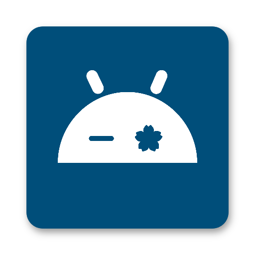

<div align="center">



# animadroid

**A native Android port of [ani-cli](https://github.com/pystardust/ani-cli)** — search, stream and download anime with a
fast Jetpack Compose UI built on **Material 3 Expressive**.

[](https://github.com/borovas-dev/animadroid/releases)
[](https://github.com/borovas-dev/animadroid/actions/workflows/ci.yml)
[](LICENSE)
[](https://github.com/borovas-dev/animadroid/releases)

-3DDC84?style=flat-square&logo=android&logoColor=white)


[](https://github.com/borovas-dev/animadroid/stargazers)

[**Download**](https://github.com/borovas-dev/animadroid/releases) ·
[Features](#-features) ·
[Providers](#-providers) ·
[Build](#-build) ·
[Credits](#-credits)

</div>

---

## 📲 Install

1. Download the latest APK from the [**Releases**](https://github.com/borovas-dev/animadroid/releases) page
2. Open it on your phone and allow "install unknown apps" for your browser or file manager when asked
3. Requires **Android 12 (API 31) or newer**. Recommendations additionally need about 6 GB of RAM and a ~2.5 GB download

## 🆕 What's new in 0.1.0
- **Shinden provider** for Polish audio and subtitles, selectable under *Settings → Playback → Source*
- **On-device recommendations** now run in an isolated process, work in release builds, and use the CPU backend by default for compatibility
- Seek-bar scrub previews, native subtitle rendering, background downloads with notification actions, backup and import, launcher icons

## ✨ Features

### 🔎 Discover and watch
- **Pluggable providers** — HiAnime and Shinden (Polish) today, more can be added behind one small interface
- **Sub / dub** switch per title, preferred quality (best, worst, 1080p to 360p) and autoplay of the next episode
- **Cover art and details** with synopsis and an episode grid, in an adaptive list-detail layout for tablets and foldables
- **Recent searches** and **favorites**, stored locally

### ▶️ Native player
- **Media3 / ExoPlayer** with HLS, a Material 3 Expressive control surface and a quality / subtitle / speed sheet
- **Seek-bar scrub previews** — a thumbnail follows your finger on the slider, from the stream's sprite sheet when available, otherwise decoded from the stream itself
- **Subtitles** rendered natively, with external tracks from the provider
- **Picture-in-Picture**, background audio with a media notification and playback controls
- **Gestures**: double-tap to seek, brightness and volume swipes, gesture lock, adjustable playback speed
- **Exact resume** — every episode remembers the second you stopped at; "Continue watching" picks up where you were

### ⏭️ ani-skip
- Optional skipping of **openings and endings** using [ani-skip](https://github.com/synacktraa/ani-skip) data (AniSkip with a MyAnimeList fallback)
- Choose between a **Skip button** and **automatic skipping**, with an adjustable offset
- Skip segments are marked on the seek bar

### 📥 Offline
- **Downloads** for offline viewing, with a foreground service, notification actions (pause, resume, cancel) and a watchdog that resumes after interruptions
- **Wi-Fi only** option for downloads
- **Backup and export** of history, progress, favorites and settings as JSON; import of an ani-cli `ani-hsts` history file

### 🤖 On-device recommendations (opt-in)
- **Gemma 4 E2B** through LiteRT-LM recommends what to watch next from your own history
- Downloaded only when you opt in, requires Wi-Fi and enough RAM, can be deleted at any time
- **Fully local inference** — your watch history never leaves the device
- Runs in an isolated process, so a native failure can never take the app down

### 🎨 Design
- **Material 3 Expressive**: expressive motion scheme, wavy progress and loading indicators, expressive components
- **Dynamic color** with a seeded fallback theme, light and dark, themed launcher icon
- Edge-to-edge, predictive back and Navigation 3

## 🌐 Providers

| Provider | Language | Notes |
|---|---|---|
| **HiAnime** | English sub / dub | Default. Ported from ani-cli v5, with a built-in Cloudflare challenge solver |
| **Shinden** | Polish (lektor, dubbing, subtitles) | Hosts: CDA, Vidara, VK, YourUpload, Sibnet and the streamwish / filemoon family |

Providers implement a small `AnimeProvider` interface (search, episodes, streams), so adding one does not touch the UI.

## 🗺️ Roadmap
- Translated subtitles through on-device ML Kit translation, starting with Chinese
- More providers and more video hosts
- Signed release builds in CI

## 🛠️ Build

Requires **JDK 21+** (CI uses 25) and Android SDK platform **37.2**.

```sh
./gradlew :app:assembleDebug          # debug APK
./gradlew :app:assembleRelease        # minified (R8) release APK, unsigned
```

After a pull or a branch switch, a stale incremental cache can cause odd Hilt errors at launch. If that happens, run
`./gradlew clean :app:assembleDebug --no-build-cache`.

<details>
<summary><b>Testing</b></summary>

- Unit tests: `./gradlew testDebugUnitTest`
- Lint: `./gradlew lint`
- UI tests: `./run-ui-tests.sh [.qa]` runs `app/src/androidTest` one test per instrumentation process (DataStore allows one instance per file per process). Compose tests drive the clock manually: the app has endless animations and the Cloudflare solver polls forever, so auto-advance would never reach idle.
- QA hook (debug builds only): `adb shell am start -n <appId>/com.borovas.animadroid.MainActivity --ez debug_force_cf true` makes every non-image request fail as a Cloudflare challenge until the in-app verification sheet finishes loading.
- Hilt/KSP: if a `MissingBinding` appears after a clean build, run `./gradlew --stop`, delete `.gradle/` and `*/build/`, and rebuild; the cause is a stale KSP incremental cache.

</details>

<details>
<summary><b>Project layout</b></summary>

```
app/                 MainActivity, navigation, theme wiring
core/                model · network · database · datastore · designsystem
provider/            api · hianime · shinden
feature/             search · details · player · aniskip · library · downloads · settings · recommend
```

</details>

## 🙏 Credits

animadroid stands on the work of others:

- [**Tsugumik**](https://github.com/Tsugumik) — inspiration for the project
- [**ani-cli**](https://github.com/pystardust/ani-cli) and its developers ([pystardust](https://github.com/pystardust)) — the original tool this app ports, including the provider flow and the history format
- [**ani-skip**](https://github.com/synacktraa/ani-skip) — opening and ending skip data and logic
- [**Cybernetic-Ransomware**](https://github.com/Cybernetic-Ransomware) — [alt-ani-cli-win-shinden](https://github.com/Cybernetic-Ransomware/alt-ani-cli-win-shinden), the reference for parts of the Shinden provider shell
- Google's [Gemma](https://ai.google.dev/gemma) and [LiteRT-LM](https://github.com/google-ai-edge/LiteRT-LM) for on-device recommendations

## ⚠️ Disclaimer

animadroid does not host, store or distribute any content. It only reads publicly available third-party sites, like
ani-cli does, and the user is responsible for what they access. See ani-cli's disclaimer.

## 📄 License

[GPL-3.0](LICENSE) — free software, like ani-cli.
